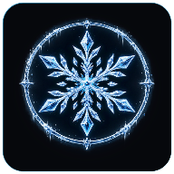

# Aura: Dynamic Notch Hub

<div align="center">
  
</div>

<div align="center">
  <strong>An interactive floating dynamic overlay for Android notifications, media sessions, incoming calls, live activities, and system events.</strong>
</div>

<br />

<div align="center">
  <a href="https://github.com/Sensui-moksha/Aura/releases"></a>
  <a href="https://github.com/Sensui-moksha/Aura/blob/main/LICENSE"></a>
  <a href="https://developer.android.com/about/versions"></a>
  <a href="https://kotlinlang.org"></a>
  <a href="https://github.com/Sensui-moksha"></a>
</div>

---

## Overview

Aura is a lightweight, privacy-focused Android application built with Kotlin, Jetpack Compose (Material 3 Expressive), and Dagger Hilt.

It consolidates notifications, active media sessions, ongoing calls, timers, and hardware status into a responsive floating pill anchored around your device's camera punch-hole cutout or display notch.

Aura operates completely offline without tracking, telemetry, or advertisements.

---

> [!WARNING]
> ### ⚠️ Disclaimer
> **Aura is provided "as is" without warranty of any kind.**  
> Due to variations in Android OEM firmware (such as Samsung OneUI, Xiaomi HyperOS/MIUI, OPPO ColorOS, and Vivo OriginOS), background process restrictions, hardware camera cutout designs, and system UI overrides, performance and feature availability may vary across different devices and Android versions.

---

## Key Features

### Dynamic Pill & Punch-Hole Cutout Ring
- **Punch-Hole Cutout Mode**: Collapses into a camera circle around the punch-hole when idle or charging, and expands into an interactive pill when notifications or media events occur.
- **Persistent Media Control**: Displays active media playback sessions with live waveform visualizer animations, album art, and expandable playback controls.
- **Multi-Tasking Split Island**: Splits into a main pill and secondary companion circle when multiple background activities occur simultaneously.

### Root & Non-Root Integration
- **Root Mode**: Automated 1-tap permission configuration via `su` (Magisk, KernelSU, SUSFS, APatch) for overlay, accessibility, and background execution enforcement.
- **Non-Root & Shizuku**: Full functionality for unrooted devices via standard Android permissions or Shizuku (`moe.shizuku.manager`).

### Customization & Layout Controls
- Configurable pill width (76 dp to 180 dp), height (8 dp to 60 dp), corner radius, and offsets (X and Y coordinates).
- Adjust transparency, floating elevation shadows, and camera cutout positioning (left, center, right).
- Integrated gesture engine supporting swipes and taps for track controls, app launching, card expansion, and dismissals.

---

## Activity Modes

| Activity Mode | Collapsed Display | Expanded View |
| :--- | :--- | :--- |
| Media & Music | Album art and audio visualizer | Full player with track title, artist, seekbar, and transport controls |
| Calls | Phone icon and call timer | Contact name, caller avatar, phone number, Answer/Decline actions |
| Timer & Countdown | Countdown timer and glyph | Gauge progress, pause/resume, and reset actions |
| Stopwatch | Live millisecond counter | Millisecond ticker, lap splits, and reset controls |
| Battery & Charging | Battery percentage and charging indicator | Wattage estimation and health status |
| Hotspot | Wi-Fi hotspot icon and device count | Connected client overview and Quick Settings shortcut |
| Bluetooth | Device glyph and battery status | Device name and battery percentage |
| Transfers & Downloads | Transfer arrow and percentage gauge | File name, speed, downloaded bytes, and cancel action |
| Screen Recording | Recording indicator and elapsed duration | Elapsed timer and quick stop button |
| Flashlight | Flashlight state indicator | Quick toggle button |
| Navigation | Directional maneuver arrows | Distance remaining, maneuver instructions, and ETA |

---

## Tech Stack

- **Language**: Kotlin 2.0+
- **UI Framework**: Jetpack Compose with Material 3 Expressive
- **Dependency Injection**: Dagger Hilt
- **State & Storage**: Kotlin Coroutines, StateFlow, DataStore, and SQLite
- **System Services**: WindowManager (`TYPE_APPLICATION_OVERLAY`), NotificationListenerService, AccessibilityService

---

## Build & Installation

### Requirements
- JDK 17 or JDK 21
- Android SDK (Compile SDK 36, Min SDK 26)
- Gradle 8.13+

### Building from Source

```bash
# Clone the repository
git clone https://github.com/Sensui-moksha/Aura.git
cd Aura

# Run unit tests
./gradlew testDebugUnitTest

# Build debug APK
./gradlew assembleDebug

# Build release APK
./gradlew assembleRelease
```

---

## Permissions Overview

| Permission | Purpose |
| :--- | :--- |
| `SYSTEM_ALERT_WINDOW` | Renders floating pill overlay |
| `BIND_NOTIFICATION_LISTENER_SERVICE` | Intercepts notifications, media, and system alerts |
| `BIND_ACCESSIBILITY_SERVICE` | Enables system gesture triggers |
| `REQUEST_IGNORE_BATTERY_OPTIMIZATIONS` | Prevents background service termination |
| `RECEIVE_BOOT_COMPLETED` | Autostarts overlay service on boot |
| `POST_NOTIFICATIONS` | Displays persistent service notification |

---

## Issues & Feedback

If you encounter bugs, feature requests, or unexpected behavior, please submit an issue or start a community discussion on GitHub:

- **Bug Reports & Complaints**: [Open an Issue](https://github.com/Sensui-moksha/Aura/issues)
- **Community Discussions**: [Start a Discussion](https://github.com/Sensui-moksha/Aura/discussions)

> **Submitting Diagnostic Logs**: When reporting a bug or crash, please export and attach the diagnostic log report file from **Settings > Developer Options > Export Diagnostic Logs** in the app. This provides system metadata, permission states, and process logcat logs to help diagnose and resolve the issue faster.

---

## License

This project is licensed under the **GNU General Public License v3.0 (GPL-3.0)**. See the [LICENSE](LICENSE) file for details.

---

## Author

- **Developer**: Sensui-moksha
- **GitHub**: [@Sensui-moksha](https://github.com/Sensui-moksha)
